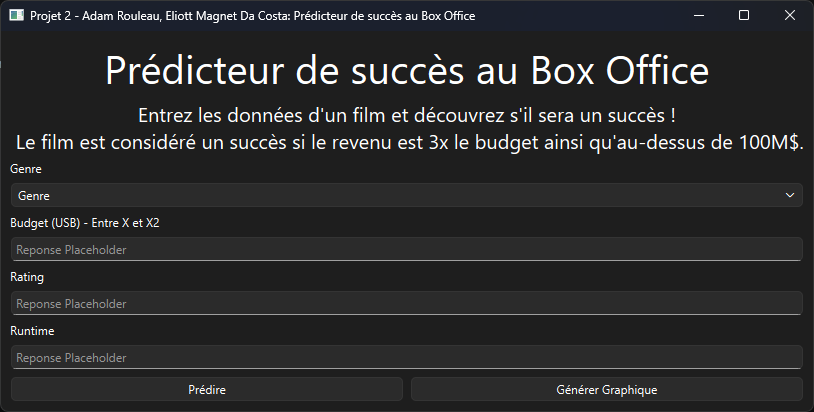
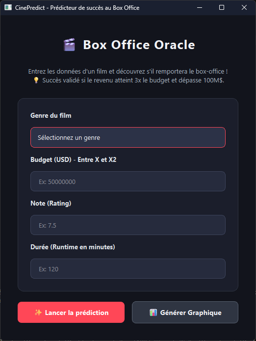

## Journal IA
<span style="color:red"> Pour des raisons évidentes, ce fichier est exempt de toute forme dutilisation d'outils d'intelligence artificielle générative. </span>

## Amélioration de l'interface graphique utilisateur
Le code original (`interface.py`) est parfaitement fonctionnel et adaptable. Il est possible de changer la taille de la fenêtre, de changer le texte et somme toute est lisible et facilement navigable pour un utilisateur lambda.
Toutefois, ce code manque de couleurs et de quelques personnalisations (police d'écriture, changement de couleur des _input fields_ quand ils sont sélelctionnés...) ainsi, le fichier a été donné à Gemini (automatique) avec l'instruction suivante:
```
Prend ce code et rend l'interface  esthétiquement satisfaisante pour un utilisateur. Modifie uniquement l'apparence et non la logique en tant que tel.
```

Avant d'être passé une deuxième fois avec l'instruction suivante:
```
Ajoute des couleurs et rend l'interface moins "ordinateur". Rend-la moins stérile. Garde toutefois les même fonctionnalités logiques. 
```

Le fichier original (`interface.py`) est encore disponible et si un utilisateur préfère avoir un programme entièrement écrit à la main au risque de sacrifier l'esthétique, il peut toujours revenir à l'ancienne interface en modifiant la ligne 7 du fichier `main.py` de cette façon.

Interface Gemini
```python
from interface_gemini2 import FenetrePrincipale
```

Interface Humaine 
```python
from interface import FenetrePrincipale
```

L'utilisateur doit également décommenter les lignes 12 à 14, permettant d'importer la stylesheet faite manuellement.
```python
    with open('src/style_interface.qss', "r") as f:
        style = f.read()
        main_window.setStyleSheet(style)
```



Lien de la conversation: https://share.gemini.google/cuvfKz5O4bVr